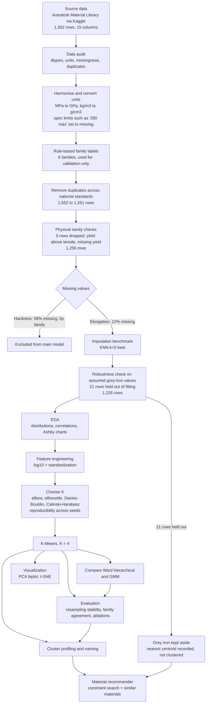
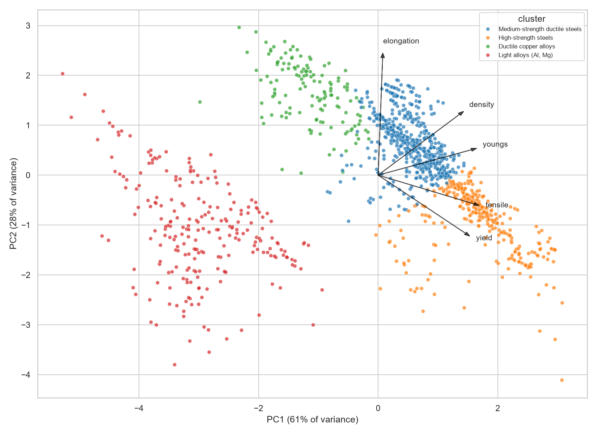
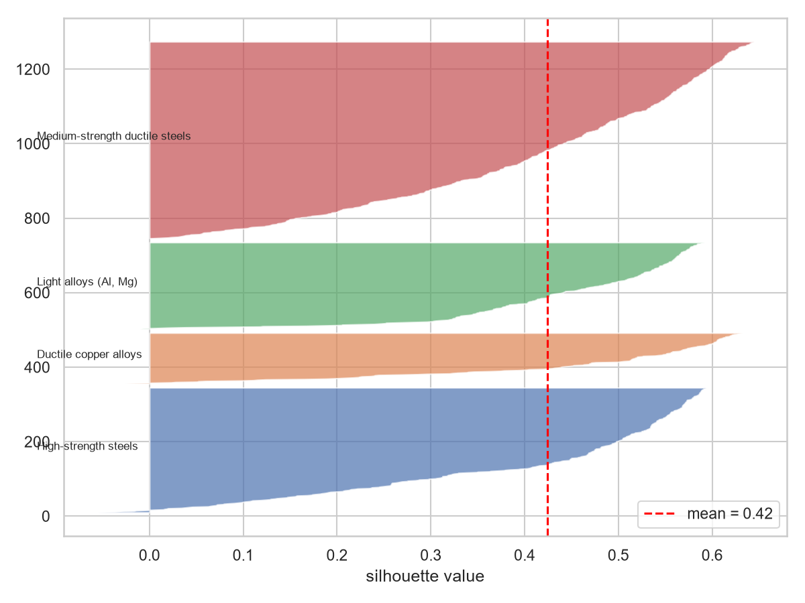

# Material Clustering for Turbine, Engine and Heavy Machinery Components

Unsupervised learning (K-Means, compared with hierarchical clustering and a Gaussian mixture) to group structural metals by their mechanical properties, so that engineers can shortlist suitable materials quickly.

## 1. Problem and objective
Choosing a material for turbines, engines and heavy machinery means trading off strength, ductility, stiffness and weight across thousands of candidates. This project groups materials with similar properties into clusters, visualizes them, and provides a screening tool that returns candidate materials from a set of requirements.

**Deliverables:** cleaned dataset and documented preprocessing; K-Means clustering with a justified choice of K; PCA and t-SNE visualizations; evaluation of stability and robustness; a material recommender.

## 2. Dataset
- **Source:** Autodesk Material Library, via Kaggle ("Materials and their Mechanical Properties", `purushottamnawale/materials`): 1,552 rows, 15 columns. The data is not redistributed here; see `data/README.md` for how to download it. Check the licence on the Kaggle page before reuse.
- **Features used (5):** tensile strength (MPa), yield strength (MPa), elongation (%), Young's modulus (GPa), density (g/cm³).
- **Scope:** structural metals only (steel, stainless steel, aluminium, copper alloys, cast iron, magnesium). The source has no superalloys, titanium or ceramics.
- **Not used:** thermal conductivity (absent from the source). Hardness (HV/HB) is 58% missing, never reported for copper or magnesium alloys, and HV and HB never occur on the same row, so it is excluded from the main model.

## 3. Workflow

## 4. Pre-processing (notebooks 01-04)
| Step | What and why |
|---|---|
| Unit conversion | E in MPa to GPa, density in kg/m³ to g/cm³ (checked against steel: ~206 GPa, ~7.86 g/cm³). |
| Specification limits | 8 yield values such as "280 max" are limits, not measurements, so they were set to missing. |
| Duplicates | The same material appears under several national standards. 291 rows with identical property sets were removed (1,552 to 1,261). |
| Sanity checks | 5 rows dropped (yield above tensile, or no yield): 1,256 rows. |
| Family labels | Rule-based text tagging into 6 families (steel, stainless steel, aluminium, copper alloy, cast iron, magnesium). Used only to validate clusters, never as a model input. |
| Missing elongation | 12.1% missing. Six imputers were benchmarked by hiding known values: KNN (k=5) had RMSE 0.65 against 1.00 for the mean or median (typical error factor 1.6 against 2.1). |
| Grey cast iron | 21 rows have no reported elongation (brittle). A first run assigned 0.5%, but a robustness check showed that assumption created a cluster by itself, so these rows were held out of model fitting (1,235 modelling rows). |
| Transform and scale | log10 then standardization. Strengths are strongly skewed in raw units (tensile 1.43, yield 2.00) and nearly symmetric after the log (-0.32, -0.10). |

## 5. Methods (notebooks 05-06)
- **Choosing K:** K-Means swept over k = 2-12 with elbow, silhouette, Davies-Bouldin and Calinski-Harabasz, plus reproducibility checks. **K = 4** has the best silhouette (0.424) and Davies-Bouldin (0.795) among k ≥ 3. K = 3 merges copper alloys with steels, K = 5 splits light alloys further and scores worse, and K = 6 is not reproducible (min ARI 0.795).
- **Algorithm comparison at K = 4:** Ward hierarchical (ARI 0.745 vs K-Means) and a Gaussian mixture (ARI 0.484, weakest on all internal metrics).
- **Visualization:** PCA (PC1 + PC2 = 88.7% of variance; trustworthiness 0.982) and t-SNE at perplexities 10, 30 and 60 (trustworthiness ~0.997).

## 6. Results
| Cluster | n | Median tensile | Median yield | Median elongation | Density |
|---|---|---|---|---|---|
| High-strength steels | 336 | 925 MPa | 685 MPa | 11% | 7.9 g/cm³ |
| Medium-strength ductile steels | 529 | 540 MPa | 315 MPa | 20% | 7.9 g/cm³ |
| Light alloys (Al, Mg) | 233 | 241 MPa | 172 MPa | 10% | 2.7 g/cm³ |
| Ductile copper alloys | 137 | 310 MPa | 131 MPa | 35% | 8.8 g/cm³ |

**Interpretation**
- PC1 is an overall "heft" axis (strength, stiffness and density all load about equally); PC2 is the ductility-versus-strength axis (elongation 0.79 against yield strength -0.39).
- Clusters follow mechanical similarity, not composition: stainless steel is not separable from steel on these five properties, and cast iron is spread across both steel clusters.
- The boundary between the two steel clusters is a convention: steel strength is a continuum (Ward disagrees on 78 rows).

**Evaluation (notebook 07)**
| Test | Result |
|---|---|
| Reproducibility (20 starts, 10 seeds) | mean ARI 0.993 |
| Resampling (100 x 80% subsets) | mean ARI 0.984 |
| Agreement with families | ARI 0.406, NMI 0.551 |
| Excluding imputed elongation rows | ARI 0.994 |
| Dropping yield / elongation / density | ARI 0.785 / 0.813 / 0.908 |
| Dropping modulus | ARI 0.566 (sensitive) |
| No log transform | ARI 0.471 (sensitive) |

## 7. Material recommender (notebook 08)
`recommend({...})` filters by property constraints and ranks by a chosen metric; `similar_to(label)` returns the closest materials in scaled property space. Example: tensile ≥ 900 MPa and elongation ≥ 10% returns only high-strength steels (SAE 4150, 4340, 8650 tempered at 400°F); density ≤ 3 g/cm³ and tensile ≥ 300 MPa returns only light alloys led by 7xxx aluminium.

## 8. Limitations
See `reports/limitations_log.md` for the full list. The main ones: metals only (no superalloys or ceramics); no thermal conductivity, creep, fatigue, corrosion, service temperature or cost, so the tool is a first-pass screen, not a final selection tool; hardness excluded; modulus is a coarse family-level value in the source (magnesium equals aluminium); results depend on the log transform and on modulus; family labels are rule-based.

## 9. How to run
1. Python 3.14 on Windows was used in development.
2. `python -m pip install -r requirements.txt`
3. Download the dataset as described in `data/README.md`.
4. `python -m jupyterlab`, then run the notebooks in order: `02_import_and_clean`, `03_eda`, `04_features_scaling`, `05_clustering`, `06_visualization`, `07_evaluation`, `08_recommender`. (`01_data_audit` is the initial audit, and `05a_assumption_check` is the evidence for excluding the assumed grey-iron values.) Use Kernel, then Restart and Run All Cells, in each.

## 10. Acknowledgements
Data: Autodesk Material Library via Kaggle (`purushottamnawale/materials`).